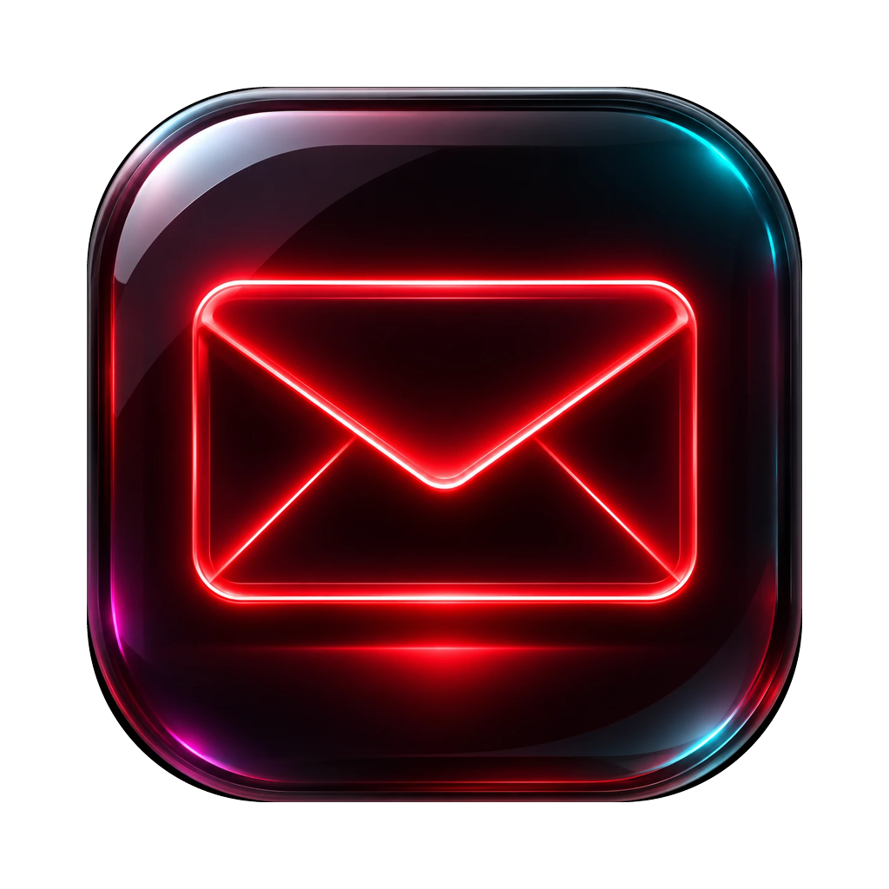

<p align="center"></p>

# Laser Email

**A private email client for macOS for people with many inboxes.** Add all your Gmail and iCloud accounts (and any
other IMAP mail) and read them in one unified inbox, in a native three-column app that looks and feels at home on
a Mac. Nothing is tracked, nothing phones home, and your mail stays on your Mac.

## Download

Get **LaserEmail-x.y.z.dmg** from [Releases](https://github.com/jamalxcode/lasermail/releases/latest) (universal:
Apple silicon and Intel, macOS 14 Sonoma or later).

1. Open the disk image and drag **Laser Email** to **Applications**.
2. The app isn't notarized by Apple yet, so the first time you open it macOS warns you. Click **Done**, then go to
   **System Settings → Privacy & Security** and click **Open Anyway**. (Or in Terminal:
   `xattr -dr com.apple.quarantine "/Applications/Laser Email.app"`.)
3. Later versions: **Laser Email ▸ Check for Updates…** downloads, checks and installs them (from 0.1.4 on).
4. Add your accounts (below). To look around with sample mail first, run
   `LASER_DEMO=1 LASER_DATA=/tmp/laser-demo "/Applications/Laser Email.app/Contents/MacOS/LaserEmail"` in Terminal.

## What it does

- 📥 **Every account, one inbox.** All Inboxes, Flagged, Drafts and Sent across accounts, plus each account's own
  folders. New mail arrives instantly (IMAP IDLE), with a notification and a Dock badge.
- 🔎 **Fast local search** across every account, including message bodies (SQLite FTS5 on your Mac).
- 🛡️ **Blocks tracking.** Remote images stay hidden until you click **Load Images** (or allow a sender). Tracking
  pixels from 100+ mail-tracking services, and 1×1 or hidden images, are blocked even then. Links lose `utm_`,
  `fbclid`, `mc_eid` and similar tags, and Google/Outlook redirect wrappers. A banner shows what was blocked.
- 🔒 **Messages can't run code.** Scripts, forms, frames, remote fonts and styles are stripped before display. The
  viewer has JavaScript off, keeps no cookies or cache, and blocks every web request at the WebKit level.
- 🕵️ **Sends quietly.** Outgoing mail has no app name, no time zone (UTC date), no computer name, and a random
  Message-ID. Read receipts are never sent. Bcc never appears in headers.
- 🔄 **Updates when you ask.** Check for Updates… fetches the newest release from GitHub and installs it only
  after verifying GitHub's proof that Laser Email's own release workflow built it. No background checks.
- 🔑 **Passwords in your Keychain.** App passwords (or Google sign-in tokens) are kept in the macOS Keychain and
  never written to disk anywhere else.
- ⌨️ **Mail's shortcuts.** ⌘N new message, ⌘R reply, ⇧⌘R reply all, ⇧⌘F forward, ⌃⌘A archive, ⌘⌫ trash, ⇧⌘L
  flag, ⇧⌘U read/unread, ⇧⌘D send, ⇧⌘N get mail. Swipe to archive, flag or delete.

## Add your accounts

| Account | What you need |
|---|---|
| **Gmail / Google Workspace** | An **app password**: Google Account → Security → 2-Step Verification → App passwords. Or **Sign in with Google** in builds that include a Google OAuth client (see `docs/gmail-oauth.md`). |
| **iCloud Mail** (icloud.com, me.com, mac.com) | An **app-specific password**: account.apple.com → Sign-In and Security → App-Specific Passwords. |
| **Other** | IMAP over TLS (993) and SMTP over TLS (465) or STARTTLS (587). |

## How it's built

A pure-Go engine (`laserd`) does the work: accounts, IMAP sync, the local database, the privacy filter and
sending. The SwiftUI app is a thin window onto it over a private Unix socket. Only three parts of the code can touch
the network (IMAP, SMTP, Google sign-in), and a test fails the build if network code appears anywhere else,
including in the app.

- `docs/BUSINESS-RULES.md`: every rule the app follows (accounts, sync, search, privacy, sending), with where it
  lives in the code.
- `docs/DECISIONS.md`: why it is built this way, what else was considered.
- `docs/privacy.md`: the privacy model. `docs/gmail-oauth.md`: enabling Sign in with Google.
- `CLAUDE.md`: the code layout and commands.

Releases publish themselves: add a `## x.y.z` section to `CHANGELOG.md` and merge to `main`; when CI passes, the
release workflow builds, checks and publishes `LaserEmail-x.y.z.dmg`.

```bash
go test -race ./...                                   # engine, on any OS
app/scripts/build-go.sh && app/scripts/bundle.sh      # macOS: build "Laser Email.app"
app/scripts/make-dmg.sh out/LaserEmail.dmg
```

Try it without an account: `go run ./cmd/laserd --demo --data /tmp/lsr --socket /tmp/lsr.sock`, then
`LASER_SOCKET=/tmp/lsr.sock go run ./cmd/laser ls`, or launch the app with `LASER_DEMO=1 LASER_DATA=/tmp/lsr`.
